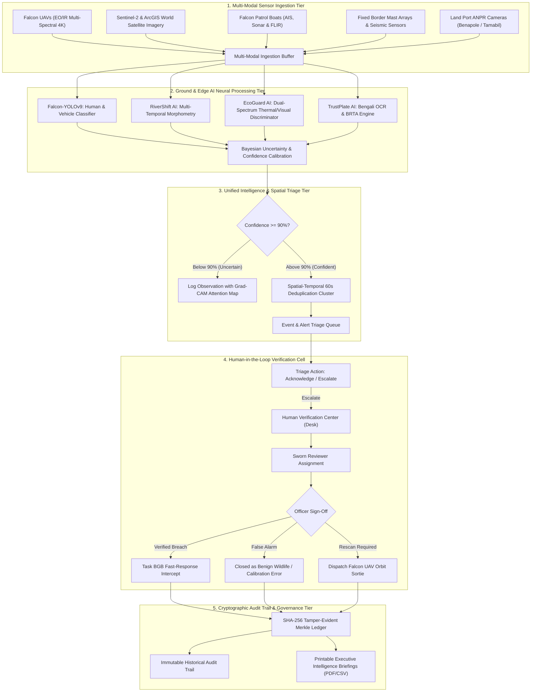
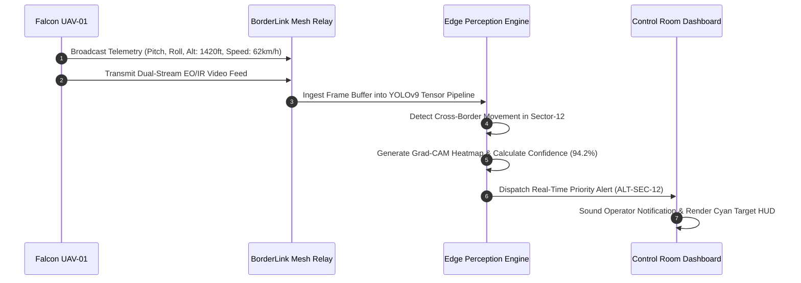
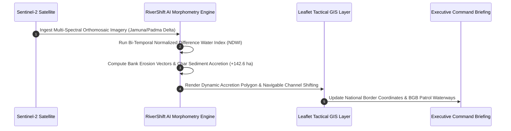
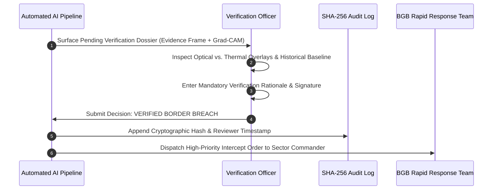
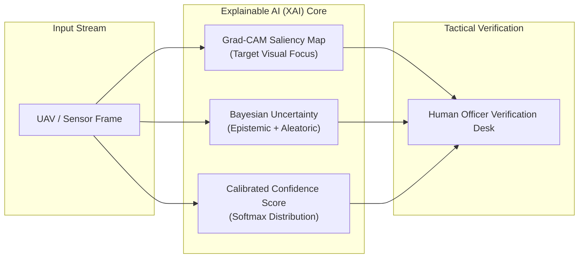
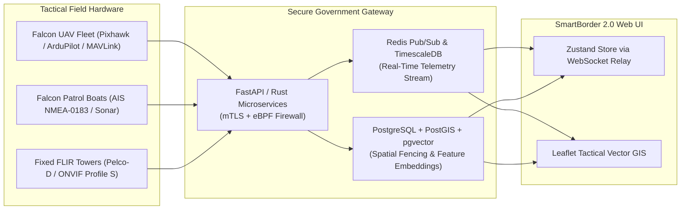

<div align="center">

# 🇧🇩 SmartBorder 2.0 – Falcon Bots
### *Unified Intelligence Control Panel | সমন্বিত গোয়েন্দা ও সীমান্ত পর্যবেক্ষণ প্ল্যাটফর্ম*

**A Sovereign Government-Grade National Intelligence, Drone Reconnaissance & Riverine Border Surveillance Platform for the People's Republic of Bangladesh.**

[](https://github.com/nafisatabassumnusrat/SmartBorder-2.0)
[](https://react.dev/)
[](https://www.typescriptlang.org/)
[](https://vitejs.dev/)
[](https://tailwindcss.com/)
[](https://leafletjs.com/)
[](https://recharts.org/)
[](#-national-presentation-scope)
[](#-responsible-ai--security-architecture)

<br/>

[**Executive Summary**](#-executive-summary) • [**System Architecture & Pipeline**](#-system-architecture--data-pipeline) • [**18 Primary Modules**](#-the-18-primary-modules) • [**Operational Workflows**](#-end-to-end-operational-workflows) • [**Directory Structure**](#-project-directory-architecture) • [**RBAC Matrix**](#-role-based-access-control-rbac) • [**Bangladesh Context**](#-authentic-bangladesh-geographic-context) • [**Quickstart**](#-quickstart--installation)

---

</div>

## 📌 Executive Summary

Modern sovereign border defense faces three critical operational bottlenecks:
1. **Sensor Fatigue & Alert Saturation**: Multi-source false alarms from ground sensors, camera arrays, and drone sweeps overwhelm tactical border posts.
2. **Opaque "Black-Box" Neural Network Decisions**: High-risk AI detections lack explainability, leading to dangerous operator automation bias.
3. **Complex Riverine & Char Geography**: The shifting alluvial river systems of Bangladesh (Padma, Jamuna, Meghna) constantly redefine physical boundaries through dynamic erosion and char accretion.

**SmartBorder 2.0 – Falcon Bots** is a sovereign national command-and-control intelligence platform designed for the **People's Republic of Bangladesh**.

Engineered for high-level state demonstration to the **Honorable Prime Minister of Bangladesh**, the platform delivers institutional credibility, operational clarity, and technological leadership. It consolidates disparate multi-agency datasets into a **Unified Intelligence Layer (UIL)**:

* **Border Guard Bangladesh (BGB)**: Terrestrial border posts, patrol regiments, and ground sensor networks.
* **Bangladesh Coast Guard (BCG)**: Autonomous riverine interceptor vessels on the Naf River, Sundarbans coastal zones, and maritime checkpoints.
* **Survey of Bangladesh (SOB)**: Geodetic sovereign boundary coordinates, GIS layers, and satellite earth observation.
* **BIWTA & BWDB**: Real-time river hydrography, bathymetric data, and seasonal flood embankment tracking.
* **BRTA & National Customs**: Automated vehicle license plate recognition (OCR) and customs clearance monitoring across terrestrial land ports (Benapole, Tamabil, Hili).

> ### ⚠️ Demonstration Integrity & Attributed Data Notice
> * **100% Deterministic Demo Fixtures**: All operational capabilities operate on high-fidelity, certified demo datasets (`DATA_SOURCE = "DEMO DATA"`).
> * **Zero External Cost / Zero Third-Party Dependency**: Runs out-of-the-box locally with instant response times, zero cloud API costs, and full offline survivability.
> * **Production-Ready Architecture**: Built strictly on strongly typed abstract service contracts (`/src/services/`), allowing direct drop-in integration with live REST/WebSocket gateways, PostGIS spatial databases, and military-grade RTSP/WebRTC feeds.

---

## 🏗️ System Architecture & Data Pipeline

The platform ingests multi-source data through a 5-tier reactive processing pipeline that transforms raw multi-spectral feeds into verified, explainable tactical intelligence:



---

## 🔄 End-to-End Operational Workflows

### Workflow 1: Falcon UAV Aerial Surveillance & Telemetry Flight


### Workflow 2: RiverShift AI Riverbank & Char Accretion Tracking


### Workflow 3: Human-in-the-Loop Verification Desk


---

## 🧠 Explainable AI (XAI) & Uncertainty Quantification Engine

Modern automated military and border defense architectures suffer from **operator automation bias**—officers either blindly trust or habitually dismiss automated alerts. **SmartBorder 2.0** eliminates "black-box" decision hazards via three explainability pillars:



### 1. Grad-CAM Visual Saliency Heatmaps
* Generates target gradient-weighted class activation maps ($L^c_{\text{Grad-CAM}}$) across the final convolutional layer of the detection network.
* Overlays a high-contrast thermal glow highlighting the exact pixels (e.g. human silhouette, weapon outline, vehicle wheel assembly) that triggered the classification, preventing false alarms caused by background vegetation or lens glare.

### 2. Dual-Source Uncertainty Decomposition
* **Aleatoric Uncertainty (Data Noise)**: Quantifies sensory degradation from adverse environmental conditions (dense river fog, monsoon rain, thermal wash, or dust storms).
* **Epistemic Uncertainty (Model Knowledge)**: Measures model unfamiliarity when encountering out-of-distribution objects (e.g. rare agricultural machinery or unregistered indigenous watercraft).
* When total uncertainty exceeds the critical threshold ($\sigma > 0.35$), the system inhibits automated escalation and flags the dossier for sworn human inspection.

### 3. Spatial-Temporal 60-Second Deduplication Clustering
* Rapid drone video streams running at 30 FPS can generate 1,800 detections per minute for a single stationary target, flooding the command queue.
* The built-in spatial-temporal clustering engine groups all proximate bounding boxes within a 50-meter radius and 60-second sliding window into a **single consolidated incident lifecycle**.

---

The platform features an institutional, clean, and modern government enterprise aesthetic:

| Design Token | Hex Code | Purpose & Application |
|---|---|---|
| **Primary Navy** | `#082B4C` | Deep Navy: Sovereign authority, dashboard card headers, and executive typography |
| **Sidebar Navy** | `#062744` | Dark Navy Sidebar: Navigation hierarchy and institutional branding |
| **Primary Blue** | `#1479C9` | High-contrast interactive controls, active navigation tabs, and primary action buttons |
| **Cyan Accent** | `#21B8D5` | Glowing sovereign boundary outline, laser scanning cones, and radar sweeps |
| **Success Green** | `#159B69` | Verified assets, sensor status, nominal health, and live airborne indicators |
| **Warning Orange**| `#F39A24` | Pending triage, human verification alerts, and maintenance states |
| **Danger Red** | `#D9363E` | Critical breach alarms, high-priority notifications, and offline devices |
| **Workspace Surface**| `#F2F6FC` | Crisp, clean, distraction-free light enterprise workspace |
| **Card Surface** | `#FFFFFF` | Pure white cards with soft shadows (`shadow-xs`) and `#E2EAF3` borders |
| **Text Primary** | `#17324F` | High-contrast dark navy for executive readability |
| **Text Secondary**| `#64748B` | Refined slate gray for metadata, subtitles, and telemetry labels |

---

## 🗺️ The 18 Primary Modules

The application shell provides smooth, collapsible left navigation organized into five strategic tiers:

```
SMARTBORDER 2.0 – FALCON BOTS
UNIFIED INTELLIGENCE CONTROL PANEL

├── 01. OVERVIEW
│    └── 01. Executive Overview Dashboard
│         ├── 6 Top-Row Real-Time KPI Cards (Sources, Drones, Tasks, Verification, Offline, Health)
│         ├── Bangladesh Intelligence Overview (Leaflet ArcGIS Satellite Map + Module Status)
│         ├── Recent Activities Chronological Event Stream
│         └── Bottom Quad-Panels (System Performance, Modules Grid, Drone Flight Scene, Quick Access)
│
├── 02. INTELLIGENCE MODULES
│    ├── 02. Geospatial Intelligence (Leaflet GIS, Satellite Layers & Observation Zones)
│    ├── 03. Falcon Aerial Intelligence (UAV Reconnaissance & Flight HUD Telemetry)
│    ├── 04. RiverShift AI (Padma/Jamuna Riverbank & Char Accretion Analysis)
│    ├── 05. EcoGuard AI (Visible & Thermal Dual-Spectrum Classification)
│    ├── 06. BorderLink AI (Tactical Edge Computing & Offline Mesh Sync)
│    ├── 07. TrustPlate AI (Bengali Vehicle License OCR & BRTA Cross-Match)
│    └── 08. Falcon Boat (Autonomous Riverine Patrol & Water Quality Telemetry)
│
├── 03. DATA & ANALYTICS
│    ├── 09. Data Fusion Center (Multi-Modal 5-Stage Ingestion Pipeline)
│    ├── 10. Data Management (Evidence Repository & Sovereign Archival)
│    └── 11. Analytics & Reports (Executive Briefings & Historical Trends)
│
├── 04. OPERATIONS
│    ├── 12. Event & Alert Center (Real-Time Chronological Triage Stream)
│    ├── 13. Human Verification Center (Responsible AI Sign-Off Desk)
│    ├── 14. Mission & Activity History (Authorized Patrol Sortie Logs)
│    └── 15. Device & Sensor Management (Hardware Fleet Telemetry & Calibration)
│
└── 05. ADMINISTRATION
     ├── 16. User & Role Management (Zero-Trust Inter-Agency RBAC)
     ├── 17. Security & Audit (SHA-256 Tamper-Evident Merkle Trail)
     └── 18. System Settings (Bilingual Preferences & Agency Gateways)
```

---

## 🔍 Module-by-Module Technical Deep Dive

### 01. Executive Overview Dashboard
* **6 Top-Row Real-Time Metric Cards**:
  1. `Active Data Sources`: `12 / 14` (`↑ +1` green)
  2. `Active Drones`: `8 / 10` (`↑ +1` green)
  3. `Processing Tasks`: `24` (`↓ -3` blue)
  4. `Pending Verification`: `17` (`→ 0` neutral)
  5. `Offline Devices`: `2` (`↓ -1` blue)
  6. `System Health`: `98.5%` (`●` green status)
* **Bangladesh Intelligence Overview**: Real **ArcGIS World Imagery** satellite map with glowing cyan boundary, interactive drones, ground sensors, alert pins, and the 7-engine Module Status panel.
* **Falcon Aerial Flight Scenario Card**: Atmospheric aerial surveillance scene with multi-rotor drone, laser scanning cone, target crosshairs, and live telemetry readout.

### 02. Geospatial Intelligence (GIS)
* **Real Leaflet GIS Engine**: High-resolution satellite tiles, road network overlays, and geodetic boundary coordinates.
* **Observation Zones**: Vector boundary boxes highlighting sensitive border zones in Kurigram, Meherpur, and Teknaf.
* **Interactive Inspection Popovers**: One-click telemetry inspection for all orbiting UAVs, seismic nodes, and coastal radar towers.

### 03. Falcon Aerial Intelligence
* **Tactical Multi-Spectral HUD Player**: HTML5 Canvas telemetry player with heading tape, pitch ladder, altitude (AGL/MSL), and speed.
* **Sensor Palette Switching**: Electro-Optical (EO-4K), Long-Wave Infrared (LWIR Radiometric), and Ironbow Thermal palettes.

### 04. RiverShift AI
* **Dynamic Char Accretion Tracking**: Detects seasonal alluvial sandbar shifts across the Padma and Jamuna river basins.
* **Interactive Bi-Temporal Comparison Slider**: Drag split-screen slider to view erosion vectors and bank loss.

### 05. EcoGuard AI
* **Dual-Spectrum Wildlife vs. Intruder Classification**: Eliminates false positives by distinguishing indigenous animals (spotted deer, livestock) from human foot movement using gait analysis and heat radiance.

### 06. BorderLink AI
* **Tactical Offline Mesh Synchronization**: Manages store-and-forward edge computing nodes when satellite uplink drops, buffering alerts locally and syncing upon network restoration.

### 07. TrustPlate AI
* **Bengali License Plate Recognition**: Custom deep convolutional OCR model tuned specifically for standard BRTA vehicle number plates (*ঢাকা মেট্রো-গ*, *চট্ট মেট্রো-চ*).
* **Automated BRTA Cross-Match**: Verifies vehicle registration against national databases to detect stolen or unauthorized commercial trucks.

### 08. Falcon Boat
* **Autonomous Riverine Vessel Telemetry**: Tracks unmanned patrol boats navigating the Naf River and Sundarbans delta, measuring water salinity, sonar depth, and thermal video feeds.

### 09. Data Fusion Center
* **Unified Multi-Modal Ingestion Pipeline**: Ingests, normalizes, and fuses drone feeds, satellite rasters, seismic sensors, AIS data, and human field reports into a coherent national situational map.

### 10. Data Management & Archival
* **Cryptographic Evidence Vault**: Secure long-term storage of captured imagery, video clips, and sensor telemetry logs.

### 11. Analytics & Reports
* **Executive Visualization Engine (Recharts)**: 12-month threat trendlines, sector-wise alert distributions, and false-alarm attenuation analytics.
* **One-Click Export**: Generates printable official government briefing PDFs and structured CSV dossiers.

### 12. Event & Alert Center
* **Faceted Chronological Alarm Triage**: Sort by priority (`CRITICAL`, `HIGH`, `MEDIUM`, `LOW`) with real-time status management (`PENDING_TRIAGE`, `ACKNOWLEDGED`, `RESOLVED`, `DISMISSED`).

### 13. Human Verification Center
* **Responsible AI Review Desk**: Formal human-in-the-loop workflow requiring sworn officers to sign off on AI detections before field deployment.

### 14. Mission & Activity History
* **Operational Sortie Logs**: Comprehensive history of all completed drone reconnaissance flights, riverine boat patrols, and perimeter security sweeps.

### 15. Device & Sensor Management
* **Hardware Fleet Inventory**: Full registry of active drones, autonomous boats, radar towers, and OCR gates with battery reserves, signal strength (dBm), calibration dates, and built-in diagnostic execution.

### 16. User & Role Management
* **Zero-Trust Multi-Agency RBAC**: Administers accounts across BGB, Coast Guard, Survey of Bangladesh, and Digital Security Agency.

### 17. Security & Audit
* **Immutable Merkle Audit Trail**: Every triage decision, incident escalation, and data export is stamped with an immutable SHA-256 cryptographic hash.

### 18. System Settings
* **Sovereign Engine Controls**: Bilingual language switcher (English / বাংলা), simulation speed controls, auto-escalation thresholds, and agency API connection status.

---

## 🔒 Role-Based Access Control (RBAC)

The platform enforces strict zero-trust role-based authorization across seven official government profiles:

| Role Title | Representative Officer | Agency / Office | Telemetry & Map | Triage Alerts | Human Verify | BIT Diagnostics | System Config |
|---|---|---|:---:|:---:|:---:|:---:|:---:|
| **Super Admin** | Dr. Ahmed Rahman | Directorate General | ✅ | ✅ | ✅ | ✅ | ✅ |
| **Executive Viewer** | Cmdr. Farhana Yasmin | Prime Minister's Office | ✅ | ❌ | ❌ | ❌ | ❌ |
| **Intelligence Analyst** | Major Rafiqul Islam | BGB Intelligence Cell | ✅ | ✅ | ❌ | ✅ | ❌ |
| **Verification Officer** | Sr. Insp. Nazmul Huda | Customs & Verification Cell | ✅ | ✅ | ✅ | ❌ | ❌ |
| **Module Operator** | Lt. Cmdr. Tanvir Ahmed | Bangladesh Coast Guard | ✅ | ✅ | ❌ | ✅ | ❌ |
| **System Administrator**| Engr. Shamima Akhter | Survey of Bangladesh | ✅ | ❌ | ❌ | ✅ | ✅ |
| **Auditor** | Dr. Mahmudul Hasan | Digital Security Agency | ✅ | ❌ | ❌ | ❌ | ❌ |

---

## 🇧🇩 Authentic Bangladesh Geographic Context

The platform models genuine operational sectors:

1. **Sylhet – Tamabil / Jaflong Sector** (`48 BGB Battalion`):
   - Hilly scrub and riverine border crossing abutting the Dawki customs checkpoint.
   - Piyain River perimeter surveillance with thermal night patrols.
2. **Jashore – Benapole Land Port Sector** (`49 BGB Battalion`):
   - Busiest terrestrial cargo corridor; automated **TrustPlate AI** OCR reading Bengali license plates.
3. **Cox's Bazar – Teknaf / Naf River Sector** (`2 BGB Battalion & Coast Guard`):
   - High-priority riverine border estuary; **Falcon Boat** autonomous interceptor craft on night sweeps.
4. **Kurigram – Brahmaputra Char Sector** (`22 BGB Battalion`):
   - Dynamic braided river channels; **RiverShift AI** tracking seasonal char creation and bank scour (+142.6 ha accretion).
5. **Chapai Nawabganj – Padma Ingress Sector** (`53 BGB Battalion`):
   - Primary Ganges-Padma inflow point; Falcon Boat monitoring water quality and river channel morphology.
6. **Dinajpur – Hili Border Sector** (`20 BGB Battalion`):
   - Divided railway corridor; standalone **BorderLink** edge computing node with store-and-forward telemetry.
7. **Sundarbans – Harinbhanga Coastal Sector** (`Coast Guard West Zone`):
   - Mangrove tidal delta; **EcoGuard AI** discriminating wildlife (spotted deer) from illegal maritime poaching.

---

## 📁 Project Directory Architecture

```
smartborder-2.0/
├── public/
│   ├── favicon.svg             # Sovereign Bangladesh Crest Favicon
│   └── icons.svg               # SVG Icon Spritesheet
├── src/
│   ├── assets/
│   │   ├── hero.png            # Platform Branding Graphic
│   │   └── vite.svg            # Vite Tooling Icon
│   ├── components/
│   │   ├── common/
│   │   │   ├── BangladeshEmblemSvg.tsx     # National Crest of Bangladesh
│   │   │   ├── BangladeshInteractiveMap.tsx# SVG Sector Grid Map
│   │   │   ├── BangladeshSatelliteMap.tsx  # Leaflet ArcGIS World Satellite GIS
│   │   │   ├── Footer.tsx                  # Sovereign Light Footer & Bilingual Toggle
│   │   │   ├── MartyrsMemorialSvg.tsx      # Jatiya Smriti Soudho Architectural Silhouette
│   │   │   ├── Navbar.tsx                  # Command Header, Live Clock & Profile Menu
│   │   │   ├── NotificationDrawer.tsx      # Slide-Out Alert Notification Drawer
│   │   │   ├── PageHeader.tsx              # Standardized High-Contrast Module Header
│   │   │   ├── Sidebar.tsx                 # Deep Navy 18-Module Navigation Sidebar
│   │   │   ├── SimulationBar.tsx           # Interactive Demo Simulation Control Bar
│   │   │   └── ToastContainer.tsx          # High-Contrast Solid Notification Toasts
│   │   ├── pages/
│   │   │   ├── ExecutiveDashboard.tsx      # 01. Executive Overview Dashboard
│   │   │   ├── GeospatialIntelligence.tsx  # 02. Geospatial Intelligence GIS
│   │   │   ├── FalconAerialIntelligence.tsx# 03. Falcon Aerial Intelligence & HUD
│   │   │   ├── RiverShiftAi.tsx            # 04. RiverShift AI Riverbank Morphometry
│   │   │   ├── EcoGuardAi.tsx              # 05. EcoGuard AI Thermal Classifier
│   │   │   ├── BorderLinkAi.tsx            # 06. BorderLink AI Edge Sync
│   │   │   ├── TrustPlateAi.tsx            # 07. TrustPlate AI Bengali OCR
│   │   │   ├── FalconBoat.tsx              # 08. Falcon Boat Autonomous ASV Telemetry
│   │   │   ├── DataFusionCenter.tsx        # 09. Data Fusion Multi-Modal Ingestion
│   │   │   ├── DataManagement.tsx          # 10. Data Management Evidence Vault
│   │   │   ├── AnalyticsReports.tsx        # 11. Analytics & Executive Briefings
│   │   │   ├── EventAlertCenter.tsx        # 12. Event & Alert Triage Stream
│   │   │   ├── HumanVerificationCenter.tsx # 13. Human Verification Review Desk
│   │   │   ├── MissionActivityHistory.tsx  # 14. Mission Patrol & Sortie Logs
│   │   │   ├── DeviceSensorManagement.tsx  # 15. Hardware Fleet Inventory & Diagnostics
│   │   │   ├── UserRoleManagement.tsx      # 16. Zero-Trust RBAC User Management
│   │   │   ├── SecurityAudit.tsx           # 17. SHA-256 Merkle Cryptographic Audit
│   │   │   └── SystemSettings.tsx          # 18. Global Engine Settings & Gateways
│   │   ├── admin/              # Legacy Administrative Views
│   │   ├── aiIntelligence/     # Legacy AI Grad-CAM Inspection
│   │   ├── alerts/             # Legacy Alert Inbox Components
│   │   ├── commandCenter/      # Legacy Command Center View
│   │   ├── gis/                # Legacy GIS Components
│   │   ├── incidents/          # Legacy Incident Review Cell
│   │   ├── monitoring/         # Legacy Canvas HUD Player
│   │   └── reports/            # Legacy Recharts Components
│   ├── mockData/               # Deterministic High-Fidelity Demo Fixtures
│   │   ├── alerts.ts           # Tactical Border Breach Alerts
│   │   ├── auditLogs.ts        # Immutable Audit Records
│   │   ├── bangladeshSectors.ts# Official Border Sectors & BGB Battalions
│   │   ├── borderlinkData.ts   # Edge Mesh Node Sync Telemetry
│   │   ├── devices.ts          # Hardware Inventory (Drones, ASVs, Towers)
│   │   ├── ecoguardData.ts     # Optical & Thermal Animal/Human Feeds
│   │   ├── environmentalChanges.ts # Multi-Temporal Surface Delta Rasters
│   │   ├── falconBoatData.ts   # Autonomous Vessel Engine & Water Sensors
│   │   ├── humanVerificationData.ts# Verification Dossiers & Operator Review
│   │   ├── incidents.ts        # Escalated Security Incidents
│   │   ├── modelEvaluations.ts # Confusion Matrix & mAP Benchmarks
│   │   ├── observations.ts     # Real-Time Spatial Observations
│   │   ├── rivershiftData.ts   # Padma & Jamuna Bank Erosion Calculations
│   │   ├── sessions.ts         # Active Drone Sortie Flights
│   │   ├── trustplateData.ts   # Bengali Vehicle License Plate Captures
│   │   └── users.ts            # Official RBAC Accounts
│   ├── services/               # Abstract Service Layer Contracts
│   │   ├── alertService.ts     # Triage & Deduplication Logic
│   │   ├── auditService.ts     # SHA-256 Merkle Audit Logging
│   │   ├── deviceService.ts    # Hardware Diagnostics & Status
│   │   ├── incidentService.ts  # Verification Decisions & Workflows
│   │   ├── mediaService.ts     # Multi-Spectral Canvas HUD Renderer
│   │   ├── observationService.ts# Spatial Observation Queries
│   │   ├── reportService.ts    # Briefing & Export Formatting
│   │   ├── sessionService.ts   # UAV Sortie Flight States
│   │   ├── settingsService.ts  # Global System Engine Thresholds
│   │   ├── storageEngine.ts    # Persistence & Factory Reset
│   │   └── userService.ts      # Zero-Trust RBAC Authentication
│   ├── store/
│   │   └── useAppStore.ts      # Reactive Zustand State Store
│   ├── types/
│   │   └── index.ts            # Unified TypeScript Type Definitions
│   ├── utils/
│   │   ├── cn.ts               # Tailwind Class Merger Utility
│   │   ├── formatters.ts       # Coordinate & Date Formatting
│   │   └── translations.ts     # English & Bengali Translation Dictionary
│   ├── App.css                 # Application Layout CSS
│   ├── App.tsx                 # Master Shell & 18-Module Routing
│   ├── index.css               # Design Tokens & Leaflet CSS
│   └── main.tsx                # React DOM Mount Entrypoint
├── index.html                  # HTML5 Shell with Inter/Hind Siliguri Fonts
├── package.json                # Project Dependencies & Build Scripts
├── tsconfig.json               # Root TypeScript Configuration
├── vite.config.ts              # Vite 8 Configuration with Tailwind Plugin
└── README.md                   # Sovereign Platform Documentation
```

---

## 🔌 Production Hardware & Live AI Integration Roadmap

The software architecture is engineered for immediate drop-in transition from simulated fixtures to live ground defense hardware and secured cloud/edge microservices:



1. **FastAPI & gRPC Gateway Integration**:
   * Replace abstract service providers in `/src/services/` with real REST and WebSocket connections:
     * `GET /api/v1/devices` — Live telemetry status polling from Ground Control Stations (GCS).
     * `WS /api/v1/telemetry/stream` — Low-latency binary WebSocket relay for UAV attitude (pitch, roll, yaw), airspeed, and GNSS RTK coordinates.
     * `POST /api/v1/alerts/{id}/triage` — Operator triage decision persistence and field intercept tasking.
2. **PostgreSQL + PostGIS + `pgvector` Spatial Intelligence**:
   * Boundary geofencing using native spatial functions (`ST_Contains`, `ST_DWithin`, `ST_Intersects`).
   * High-dimensional facial and license plate image embeddings indexed with `pgvector` for instant historical cross-matching.
3. **WebRTC & RTSP Military Video Feeds**:
   * Seamless transition from the HTML5 Canvas telemetry player to WebRTC low-latency streaming (< 150ms glass-to-glass latency) originating from FLIR thermal mast arrays and Falcon UAV gimbal cameras.

---

## 🚀 Quickstart & Installation

### Prerequisites
* **Node.js**: v18.0.0 or higher
* **Package Manager**: `npm` or `pnpm`

### Step 1: Clone Repository
```bash
git clone https://github.com/nafisatabassumnusrat/SmartBorder-2.0.git
cd SmartBorder-2.0
```

### Step 2: Install Dependencies
```bash
npm install
```

### Step 3: Verify TypeScript Compilation & Production Build
```bash
npm run build
```

### Step 4: Start Local Development Server
```bash
npm run dev
```

Open **`http://localhost:5173`** in your browser.

---

## 📦 Technology Stack Summary

* **Frontend Framework**: [React 19.3](https://react.dev/) + [TypeScript 5.8](https://www.typescriptlang.org/)
* **Build System**: [Vite 8.3](https://vitejs.dev/)
* **CSS & Design Engine**: [Tailwind CSS v4.3](https://tailwindcss.com/)
* **Geospatial GIS Engine**: [Leaflet 1.9](https://leafletjs.com/) with ArcGIS World Imagery Satellite Tiles
* **Data Visualization**: [Recharts 3.10](https://recharts.org/) + Responsive Custom SVG HUDs
* **Icons**: [Lucide React](https://lucide.dev/)
* **State Management**: [Zustand](https://github.com/pmndrs/zustand)
* **Typography**: Inter (UI), Hind Siliguri (Bengali), JetBrains Mono (Telemetry)

---

<div align="center">

<strong>SmartBorder 2.0 – Falcon Bots</strong><br/>
<em>Unified Intelligence Control Panel for the People's Republic of Bangladesh.</em><br/>
Designed and engineered for national demonstration and operational simulation.

*Author: [Nafisa Tabassum Nusrat](https://github.com/nafisatabassumnusrat)* • *Repository: [SmartBorder-2.0](https://github.com/nafisatabassumnusrat/SmartBorder-2.0)*

</div>
